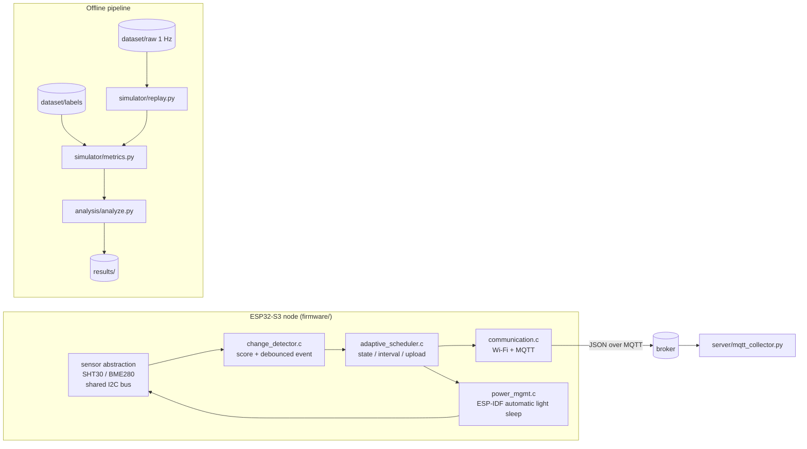

<h1 align="center">AdaptiveSense</h1>

<p align="center"><strong>Change-Aware Adaptive Sampling for IoT Nodes</strong></p>

<p align="center">Change Detection · Sampling Cost · Event Retention</p>

---

<p align="center">
  <a href="#project-overview">Overview</a> ·
  <a href="#method-and-workflow">Method</a> ·
  <a href="#implementation-and-hardware-status">Status</a> ·
  <a href="#relationship-to-smart-agriculture-edge-ai">Related System</a> ·
  <a href="README_zh.md">简体中文</a>
</p>

---

<a id="project-overview"></a>

AdaptiveSense studies **Change-Aware Adaptive Sampling** for resource-constrained IoT nodes. It adjusts sampling intervals and upload decisions as environmental signals change, measuring the tradeoff between sensing/communication cost and retained event information. The repository includes a Python replay simulator and an ESP32-S3 C implementation following the same [algorithm specification](docs/change_score_spec.md).

## Research question

Can a node sample and transmit less while preserving event detection? Sparse observations save work during quiet periods, but a short event can occur entirely between samples. AdaptiveSense reports both the savings and the events its policy misses.

## Method and workflow

1. **Score change.** For each valid channel, combine deviation from a persistent EMA baseline, windowed population standard deviation, and mean absolute rate of change. Normalize by that channel's noise floor; use the maximum channel score.
2. **Adapt the interval.** A hysteretic `STABLE → ACTIVE → ALERT` state machine escalates immediately and de-escalates one level at a time. Interval ladders are STABLE `[20, 40, 60]` s, ACTIVE `[15, 10, 5]` s, ALERT `[5]` s.
3. **Request uploads.** Send on the first sample, event onset, state/interval changes, heartbeat, or sufficient change since the last upload request. Online events require the score to exceed a threshold for a minimum duration.



The sensor abstraction supports SHT30 and BME280 backends plus an optional BH1750 light channel on a shared I²C bus. Policy code is independent of sensor/radio drivers. Python and host-compiled firmware policy sources are compared decision by decision; [experiment configuration](experiments/experiment_config.yaml) is checked against the firmware configuration.

## Key findings: synthetic replay

Seven scenarios contain 26,400 s of 1 Hz synthetic signal and 24 channel-level labels from 13 physical disturbances. Every strategy sees the same signal and independent ground truth. The shared offline detector scores **event information retained in sampled streams**, rather than the firmware's global `event_active` flag.

| Strategy | Samples | Uploads | Upload reduction | Detected / labels | Detection rate | Mean latency |
| --- | ---: | ---: | ---: | ---: | ---: | ---: |
| Fixed-5s | 5280 | 5280 | 80.0 % | 22/24 | 91.7 % | 12.3 s |
| Fixed-10s | 2640 | 2640 | 90.0 % | 22/24 | 91.7 % | 17.3 s |
| Fixed-20s | 1320 | 1320 | 95.0 % | 19/24 | 79.2 % | 35.9 s |
| Fixed-40s | 660 | 660 | 97.5 % | 17/24 | 70.8 % | 62.9 s |
| Fixed-60s | 440 | 440 | 98.3 % | 11/24 | 45.8 % | 111.7 s |
| **AdaptiveSense** | **1178** | **768** | **97.1 %** | **18/24** | **75.0 %** | **41.2 s** |

Results are micro-aggregated, not averages of scenario rates. Upload reduction is relative to the 1 Hz source: `1 − application_uploads / source_samples`. It excludes Wi-Fi, TCP, MQTT keepalive and other radio overhead; it is not a measured radio-traffic or energy reduction.

AdaptiveSense lies between Fixed-20s and Fixed-40s on this benchmark; it does not outperform the fixed-rate tradeoff curve. It misses 6 labels and produces 17 false-positive detections, of which 11 occur outside labeled events (false alarms). Five of those false alarms come from the noisy-stable scenario.

Representative failures:

- **Short event (E):** a 26 s spike is missed at a 60 s interval; neither of its two labels is detected.
- **Slow drift (G):** a +3 °C ramp over 30 minutes is missed by every strategy, including Fixed-5s. The 60 s EMA reference follows the trend before deviation reaches the threshold; an explicit trend term or slower reference is needed.
- **Mixed workload (C):** the upward step is detected and the downward step is missed (2/4 labels). At long intervals, the baseline decay and 10 s debounce cannot be established from a single observation.

Full scenario counts and latency distributions: [metrics_all.csv](results/metrics_all.csv), [metrics_summary.csv](results/metrics_summary.csv), and [plots](results/plots/). Definitions and matching rules: [methodology](docs/methodology.md), [dataset guide](dataset/README.md), and [engineering audit](docs/audit_v0.2.md).

## Implementation and hardware status

| Capability | Evidence and scope |
| --- | --- |
| Python simulator / C policy | Synthetic replay and host parity checks |
| ESP32-S3 firmware | Built with ESP-IDF v5.4.4; physically flashed and run |
| SHT30 temperature/humidity + BH1750 light | Physical readings reach the detector and scheduling policy |
| BME280 / pressure | Driver host-tested; no fitted BME280 or physical validation |
| Wi-Fi / MQTT | Multi-cycle hardware runs with a local broker; node/collector cross-checks |
| Power management | Automatic light-sleep configuration and observed sleep statistics; no measured current or energy |
| Deep sleep | Experimental and rejected at compile time because it loses scheduling state |
| Soil-moisture ADC | Experimental raw/calibrated-voltage telemetry; not volumetric water content |

The SHT30/BH1750 run verifies the implemented sensing path, not the synthetic detection rates. Firmware separates `upload_requested` from `publish_call_ok`; at MQTT QoS 0, the latter means client acceptance, not delivery confirmation. See [hardware sessions](docs/hardware_test_log.md), [hardware notes](docs/hardware.md), [build record](docs/build_validation.md), and [power management](docs/power_management.md).

## Quick start and reproduction

Requirements: Python 3.10+, a C compiler for host checks, and ESP-IDF v5.4 for firmware.

```bash
python3 -m venv .venv
source .venv/bin/activate
python -m pip install -r requirements.txt
python dataset/generate_dataset.py
python scripts/check_config_parity.py
python analysis/analyze.py
```

Firmware, from an ESP-IDF shell:

```bash
cd firmware
idf.py set-target esp32s3
idf.py build
```

The build provisions the ignored `config.h` from its committed example; credentials are not needed to build. Optional host checks: `python -m pytest tests/ -v`. Real-data collection follows the [experiment protocol](docs/experiment_protocol.md).

## Relationship to Smart-Agriculture-Edge-AI

[Smart-Agriculture-Edge-AI](https://github.com/Sver0411/Smart-Agriculture-Edge-AI) reuses AdaptiveSense's sampling and change-detection implementation. AdaptiveSense remains an independent policy study; its synthetic metrics and standalone device runs are separate from the main system's evidence.

## Limitations and future work

- One small synthetic benchmark and hand-selected parameters do not establish performance in agriculture or other environments. Advanced adaptive-sampling baselines have not been compared.
- Sparse sampling, baseline adaptation, and debounce jointly cause missed events; joint parameter selection and drift-sensitive scoring remain research priorities.
- A runtime I²C bus wedge has no automatic bus recovery; the recovery procedure runs at bus creation. This was observed and released manually.
- Cost figures are counts and dimensionless proxies. Hardware current/energy measurements, longer real-data evaluation, and end-to-end delivery confirmation remain pending.

## License

AdaptiveSense is [MIT](LICENSE). `firmware/main/bme280_math.c` reproduces Bosch Sensortec's `BME280_SensorAPI` compensation equations under **BSD-3-Clause**; attribution is preserved in [THIRD_PARTY_NOTICES.md](THIRD_PARTY_NOTICES.md) and the source file.
