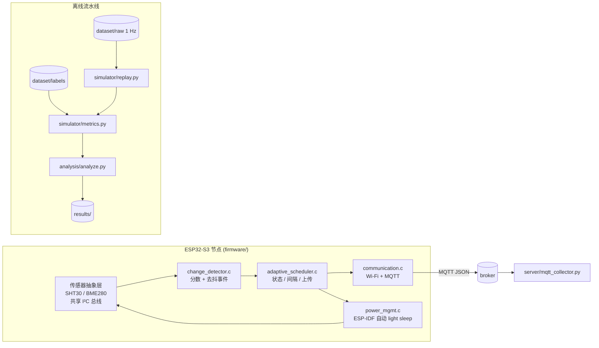

<h1 align="center">AdaptiveSense</h1>

<p align="center"><strong>面向 IoT 节点的变化感知自适应采样</strong></p>

<p align="center">变化检测 · 采样开销 · 事件保留</p>

---

<p align="center">
  <a href="#project-overview">概览</a> ·
  <a href="#方法与流程">方法</a> ·
  <a href="#实现与硬件状态">验证状态</a> ·
  <a href="#relationship-to-smart-agriculture-edge-ai">主项目关联</a> ·
  <a href="README.md">English</a>
</p>

---

<a id="project-overview"></a>

AdaptiveSense 研究面向资源受限 IoT 节点的**变化感知自适应采样（Change-Aware Adaptive Sampling）**。它根据环境变化调整采样间隔和上传决策，衡量采样/通信开销与事件信息保留之间的权衡。仓库包含遵循同一[算法规范](docs/change_score_spec.md)的 Python 回放仿真与 ESP32-S3 C 实现。

## 研究问题

节点能否减少采样与发送，同时保留事件检测能力？稀疏观测能减少平稳时期的工作量，但短事件可能完全落在两次采样之间。AdaptiveSense 同时报告节省的开销和漏检事件。

## 方法与流程

1. **变化评分：** 对有效通道计算相对持久 EMA 基线的偏差、窗口总体标准差、平均绝对变化率；按通道噪声底归一化，取各通道最大评分。
2. **自适应间隔：** 带滞回的 `STABLE → ACTIVE → ALERT` 状态机立即升级、逐级降级。STABLE 间隔为 `[20, 40, 60]` s，ACTIVE 为 `[15, 10, 5]` s，ALERT 为 `[5]` s。
3. **上传请求：** 首次采样、事件开始、状态/间隔变化、心跳或相对上次上传请求的变化达到阈值时发送。在线事件要求评分持续超过阈值一定时间。



传感器抽象支持 SHT30、BME280 两种后端，并在共享 I²C 总线上支持可选 BH1750 光照通道。策略代码不依赖传感器或通信驱动；Python 与主机编译的固件策略逐决策对比，[实验配置](experiments/experiment_config.yaml)与固件配置保持一致性检查。

## 主要发现：合成数据回放

七个场景包含 26,400 s 的 1 Hz 合成信号，由 13 个物理扰动产生 24 个通道级标签。各策略使用相同信号和独立真值。共享离线检测器衡量的是**采样流保留的事件信息**，不是固件全局 `event_active` 标志的准确率。

| 策略 | 采样数 | 上传数 | 上传减少比例 | 检出 / 标签数 | 检出率 | 平均延迟 |
| --- | ---: | ---: | ---: | ---: | ---: | ---: |
| Fixed-5s | 5280 | 5280 | 80.0 % | 22/24 | 91.7 % | 12.3 s |
| Fixed-10s | 2640 | 2640 | 90.0 % | 22/24 | 91.7 % | 17.3 s |
| Fixed-20s | 1320 | 1320 | 95.0 % | 19/24 | 79.2 % | 35.9 s |
| Fixed-40s | 660 | 660 | 97.5 % | 17/24 | 70.8 % | 62.9 s |
| Fixed-60s | 440 | 440 | 98.3 % | 11/24 | 45.8 % | 111.7 s |
| **AdaptiveSense** | **1178** | **768** | **97.1 %** | **18/24** | **75.0 %** | **41.2 s** |

结果采用合并计数的 micro 聚合，不是场景检出率的平均。上传减少比例相对 1 Hz 源信号计算：`1 − application_uploads / source_samples`，不包含 Wi-Fi、TCP、MQTT 心跳等开销，不能视为实测无线流量或能耗减少。

AdaptiveSense 位于 Fixed-20s 与 Fixed-40s 的权衡之间，没有超越固定间隔的权衡曲线。它漏检 6 个标签，产生 17 次假阳性检测，其中 11 次位于标签事件之外（误报警）；5 次误报警来自噪声平稳场景。

代表性失败：

- **短事件（E）：** 60 s 间隔下漏掉 26 s 尖峰，两个标签均未检出。
- **慢漂移（G）：** 30 分钟内 +3 °C 的斜坡被所有策略漏掉，包括 Fixed-5s。60 s EMA 基线在偏差达阈值前跟上趋势，需要显式趋势项或更慢参考。
- **混合场景（C）：** 检出上升阶跃，漏掉下降阶跃（2/4 标签）。长间隔下，基线衰减与 10 s 去抖要求无法由单次观测满足。

完整场景计数、延迟分布见 [metrics_all.csv](results/metrics_all.csv)、[metrics_summary.csv](results/metrics_summary.csv)和[图表](results/plots/)。指标与匹配规则见[方法](docs/methodology.md)、[数据集说明](dataset/README.md)和[工程审计](docs/audit_v0.2.md)。

## 实现与硬件状态

| 能力 | 证据与范围 |
| --- | --- |
| Python 仿真 / C 策略 | 合成回放与主机一致性检查 |
| ESP32-S3 固件 | ESP-IDF v5.4.4 构建，已真机刷写与运行 |
| SHT30 温湿度 + BH1750 光照 | 实际读数进入检测器和采样策略 |
| BME280 / 气压 | 驱动经主机测试，未装配 BME280，未真机验证 |
| Wi-Fi / MQTT | 本地 broker 多周期真机运行，节点与采集器核对 |
| 电源管理 | 自动轻睡眠配置及睡眠统计；尚未测量电流或能耗 |
| 深睡眠 | 实验性；因调度状态丢失而在编译期拒绝 |
| 土壤湿度 ADC | 实验性原始/校准电压遥测，不是体积含水率 |

SHT30/BH1750 运行验证了实际采集路径，不证明合成数据检出率。固件分别记录 `upload_requested` 和 `publish_call_ok`；MQTT QoS 0 下，后者表示客户端接受请求，不是送达确认。详见[真机记录](docs/hardware_test_log.md)、[硬件说明](docs/hardware.md)、[构建记录](docs/build_validation.md)和[电源管理](docs/power_management.md)。

## 快速开始与复现

需要 Python 3.10+、用于主机检查的 C 编译器，以及固件所需的 ESP-IDF v5.4。

```bash
python3 -m venv .venv
source .venv/bin/activate
python -m pip install -r requirements.txt
python dataset/generate_dataset.py
python scripts/check_config_parity.py
python analysis/analyze.py
```

在 ESP-IDF 环境构建固件：

```bash
cd firmware
idf.py set-target esp32s3
idf.py build
```

构建会由已提交示例生成被忽略的 `config.h`，构建不需要凭据。可选主机检查：`python -m pytest tests/ -v`。真实数据采集见[实验协议](docs/experiment_protocol.md)。

## Relationship to Smart-Agriculture-Edge-AI

[Smart-Agriculture-Edge-AI](https://github.com/Sver0411/Smart-Agriculture-Edge-AI) 复用了 AdaptiveSense 的采样和变化检测相关实现。AdaptiveSense 仍是独立策略研究，其合成数据指标与独立真机运行证据不同于主系统的证据。

## 局限与后续工作

- 小规模合成基准与手选参数不能证明农业或其他环境的效果；尚未比较更先进的自适应采样算法。
- 稀疏采样、基线适应和去抖共同造成漏检，联合参数选择与漂移敏感评分是后续重点。
- 运行中 I²C 总线卡死没有自动总线恢复，恢复程序仅在创建总线时运行；曾观察到并手动解除。
- 开销指标是计数与无量纲代理。硬件电流/能耗测量、更长真实数据评估和端到端送达确认尚待完成。

## 许可证

AdaptiveSense 使用 [MIT](LICENSE)。`firmware/main/bme280_math.c` 按 **BSD-3-Clause** 复现 Bosch Sensortec `BME280_SensorAPI` 补偿公式，归属说明保留于 [THIRD_PARTY_NOTICES.md](THIRD_PARTY_NOTICES.md)和源文件中。
